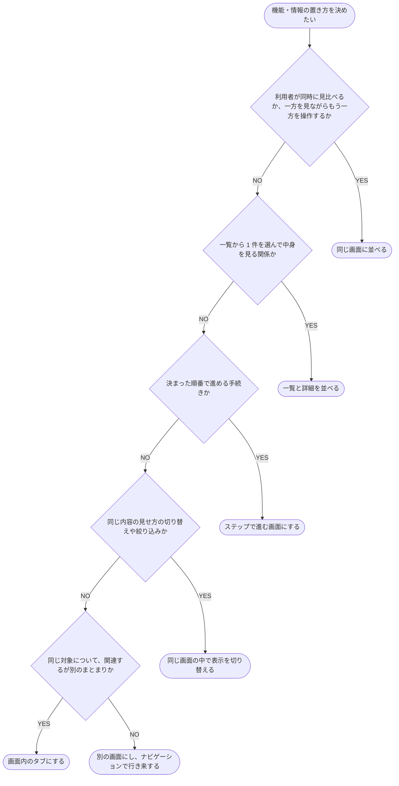
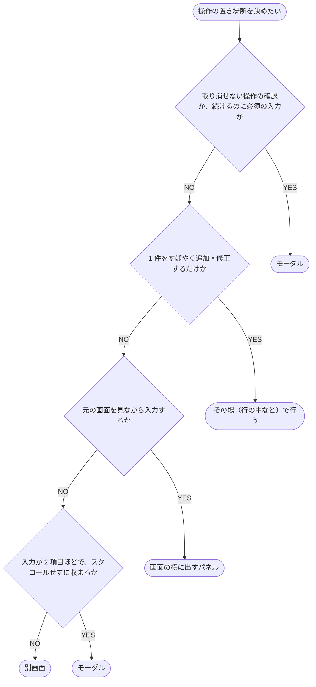

# 画面の分け方

機能・情報や操作を同じ画面・タブ・パネル・モーダル・別画面のどれで扱うかと、画面間の移り方を決める。
出典の略号は N = Nielsen Norman Group、M = Microsoft、A = Apple Human Interface Guidelines、D = Android Developers、C = IBM Carbon Design System、G = GOV.UK Service Manual、GL = GitLab Pajamas（リンクは `## 出典`）。
数値は出典の値で、目安として扱う。

## 機能・情報の置き方

<!-- table: data -->

| 判定 | YES のとき | 出典 |
| --- | --- | --- |
| 利用者が同時に見比べるか、一方を見ながらもう一方を操作するか | 同じ画面に並べる。片方が主を補う情報なら、主の横に補助の区画を置く。狭い幅では、補助の区画は主の下か、下から出す面に置く | N / C / D |
| 一覧から 1 件を選んで中身を見る関係か | 一覧と詳細を並べる。狭い幅では別画面に分け、戻る操作で一覧へ戻す | M / D |
| 決まった順番で進める手続きか | ステップで進む画面にする。不慣れな利用者がたまに行う手続きは 1 画面 1 問から始め、慣れた利用者が繰り返す手続きは使われ方を確かめてからまとめる | C / N / G |
| 同じ内容の見せ方の切り替えや絞り込みか | 同じ画面の中で表示を切り替える | C |
| 同じ対象について、関連するが別のまとまりか | 画面内のタブにする | C / N |
| どれにも当たらない | 別の画面にし、ナビゲーションで行き来する | M |

<!-- /table -->

## 操作の置き場所

作成・編集・確認の操作に当てる。

| 判定 | YES のとき | 出典 |
| --- | --- | --- |
| 取り消せない操作の確認か、続けるのに必須の入力か | モーダル | N / C / A |
| 1 件をすばやく追加・修正するだけか | その場（行の中など）で行う | C |
| 元の画面を見ながら入力するか | 画面の横に出すパネル | C |
| 入力が 2 項目ほどで、スクロールせずに収まるか | モーダル | C |
| どれにも当たらない（区画に分かれる・複数のステップがある・使い始める前に必ず済ませる） | 別画面 | C |

編集は作成と同じ置き方にし、編集できる項目の数が作成と大きく違うときだけ変える（C）。

## 構造と遷移

<!-- table: data -->

| 要素 | 出典 |
| --- | --- |
| 並列の画面が 7 つ以下で、どの順でも見られ、親子関係が無いなら、直接行き来できる並びにする。順序や親子関係がある、または 8 つ以上なら階層に分ける | M |
| 行き来する画面が 5 つを超えるなら、横のメニューにする | M / C |
| 横のメニューは 2 階層まで。3 階層目は画面内のタブにする | C |
| 階層が 3 以上になるなら、現在地までの経路（パンくず）を出す | M |
| タブやメニューで切り替える先には、同じ親に属する画面だけを並べる | M |
| 関連する項目へ移るのに、一度上の画面へ戻らせない。一覧と詳細を並べるか、前後へ移る手段を置く | M |
| 戻る操作は見てきた順に戻る。ダイアログやパネルは閉じるだけにして履歴に積まない。一覧と詳細の中で項目を切り替えるのも積まない | M / D |
| 画面を直接開いたときも、辿って来たときと同じように上の画面へ戻れる | D |
| 開閉で隠す階層は 2 階層まで。行き来しながら見直し合う項目は、隠さず 1 画面に置く | N |
| 幅が変わっても選んでいた項目を保ち、狭くなるときは見ていた側を残す | D |
| 選ぶ部品は、選んだ結果が出る場所より上に置く | - |

<!-- /table -->

## タブ

<!-- table: data -->

| 要素 | 出典 |
| --- | --- |
| 最初に開くタブに主な内容を置き、他のタブには補足を置く | N |
| 1 つのタブの並びに、画面内の切り替えと別画面への移動を混ぜない。どのタブも同じ見た目・同じ動きにする | N |
| 収まりきらずに隠れるほどの数のタブにしない | A / N |
| タブは移動にだけ使い、操作のボタンを置かない | A |
| 中身が無くてもタブを非表示にしたり押せなくしたりせず、中身が無い理由をタブの中に出す | A |
| 別の中身へ切り替えるときはタブ、同じ中身の見せ方を変えるときはセグメント（ラジオ相当）を使う。タブを 2 階層に重ねない | GL |
| 各タブに、その中身の件数を出す | - |

<!-- /table -->

## モーダル

| 要素 | 出典 |
| --- | --- |
| 判断に外の情報が要る作業、今の作業と関係のない案内、繰り返し行う作業には使わない | N / C |
| 利用者の操作をきっかけにしてだけ開く。裏で動く処理の知らせは通知で出す | C |
| モーダルから別のモーダルを開かない。モーダルの中を階層にしない | C / A |
| 大きいモーダルにも収まらない内容は別画面にする | C |
| 入力した内容が消える閉じ方には確認を挟む | A |

## 出典

- N: [Tabs, Used Right](https://www.nngroup.com/articles/tabs-used-right/)・[Modal & Nonmodal Dialogs](https://www.nngroup.com/articles/modal-nonmodal-dialog/)・[Progressive Disclosure](https://www.nngroup.com/articles/progressive-disclosure/)
- M: [Navigation basics for Windows apps](https://learn.microsoft.com/en-us/windows/apps/design/basics/navigation-basics)
- A: [Tab bars](https://developer.apple.com/design/human-interface-guidelines/tab-bars)・[Modality](https://developer.apple.com/design/human-interface-guidelines/modality)
- D: [Principles of navigation](https://developer.android.com/guide/navigation/principles)・[Canonical layouts](https://developer.android.com/develop/ui/compose/layouts/adaptive/canonical-layouts)
- C: [Tabs](https://carbondesignsystem.com/components/tabs/usage/)・[Content switcher](https://carbondesignsystem.com/components/content-switcher/usage/)・[Modal](https://carbondesignsystem.com/components/modal/usage/)・[Dialogs](https://carbondesignsystem.com/patterns/dialog-pattern/)・[UI shell left panel](https://carbondesignsystem.com/components/UI-shell-left-panel/usage/)・[Create flows](https://carbondesignsystem.com/community/patterns/create-flows/)・[Edit](https://carbondesignsystem.com/community/patterns/edit-pattern/)
- G: [Structuring forms](https://www.gov.uk/service-manual/design/form-structure)
- GL: [Segmented control](https://design.gitlab.com/components/segmented-control)
