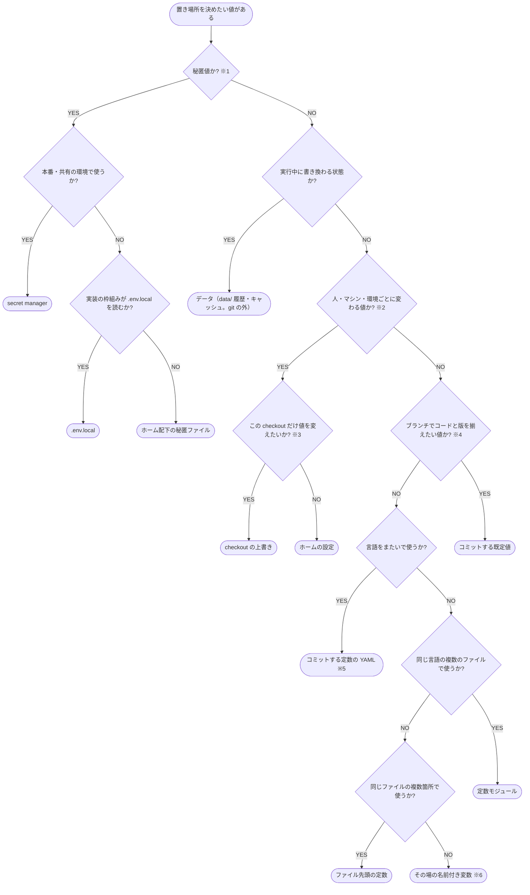

# 設定値の置き場所 判定フローチャート

設定値・秘匿値・定数を、リポジトリのどこに置くか、リポジトリの外のどこに置くかを判定

プロンプト・キャラクターなどの定義・素材の一覧・評価のケース・カタログはこの判定の対象外で、[コンテンツの置き場所](../コーディング規約/dev/コンテンツの置き場所.md) に従う。

- **※1 秘匿値**: API キー・パスワード・トークン・秘密鍵など、漏れると悪用される値。git 管理下にもログにも置かない
- **※2 環境の値**: 接続先・費用の上限・マシンごとのパスなど、形はほぼ変わらず値だけが人・マシン・環境で変わる値
- **※3 checkout の上書き**: ブランチで試したい値など、その clone だけで変える値。リポジトリ直下の `settings.local.yaml`（git の外）に書く
- **※4 既定値**: 項目の一覧・辞書と既定値（retry・timeout・機能フラグなど、コードを変えずに調整する値。最大長のようにコードの前提になる値は含めない）。項目の形の正本で、ブランチのコードと同じ版で読めるようリポジトリにコミットする
- **※5 定数の YAML**: ラベル名のように、コードと文書が言語をまたいで共有する定数の正本（`config/constants.yaml` 等）。設定の 3 段に入れず、環境の値や checkout の上書きで上書きされない
- **※6 その場の名前付き変数**: 使う 1 か所の近くで値に名前を付ける。値だけでは意味が読み取れないときも、その場で名前を付ける

## 設定の 3 段

設定は次の 3 段に置き、後の段が勝つ。

| 段 | 置き場所 | git | 持つ値 |
| --- | --- | --- | --- |
| 既定値 | リポジトリの `config/defaults.yaml` | 管理する | 項目の一覧と既定値 |
| 環境の値 | `~/.config/{project}/settings.yaml`（秘匿値だけ分けるときは `~/.config/{project}/secrets/`） | 管理外（ホーム配下） | 接続先・秘匿値・費用の上限など |
| checkout の上書き | リポジトリ直下の `settings.local.yaml` | 管理外（`.gitignore`） | その checkout だけの値 |

- 読む順は 既定値 → 環境の値 → checkout の上書き。checkout の上書きは無ければ飛ばし、在るのに読めなければ既定値と同じくエラーにする
- 既定値が読めないときはエラーにする
- その実行だけ値を変えるときは、環境変数・引数で上書きする（3 段のどれよりも優先する）
- ブランチで既定値へ移した項目を足す・改名しても、ホームの設定を書き換えずに他のブランチの checkout を動かせる
- 環境の値と秘匿値のファイルには、実値を入れないサンプル（`settings.sample.yaml`、`.env.local` を使うときは `.env.sample`）を対でコミットし、必要なキーの一覧にする

## 出典

<!-- table: data -->

| 出典 | 取り込んだ要素 |
| --- | --- |
| [The Twelve-Factor App: Config](https://12factor.net/config) | 環境ごとに変わる値はコードの外に置く |
| [XDG Base Directory Specification](https://specifications.freedesktop.org/basedir/latest/) | ユーザーごとの設定は `~/.config`（`$XDG_CONFIG_HOME`）の下に置く |
| [Microsoft: ASP.NET Core での開発時のアプリのシークレット](https://learn.microsoft.com/aspnet/core/security/app-secrets) | 開発時の秘匿値はプロジェクトのツリーの外（ユーザーのプロファイル）に置く |
| [OWASP Secrets Management Cheat Sheet](https://cheatsheetseries.owasp.org/cheatsheets/Secrets_Management_Cheat_Sheet.html) | 本番の秘匿値は secret manager に集め、コードにもログにも出さない |
| [Claude Code: Settings](https://code.claude.com/docs/en/settings) | ユーザー → プロジェクト（コミット）→ ローカル（git の外）の順に重ね、後のものが勝つ |
| [Vite: Env Variables and Modes](https://vite.dev/guide/env-and-mode) | `.env.local` は git の外に置き、その checkout だけの値を持つ |

<!-- /table -->
