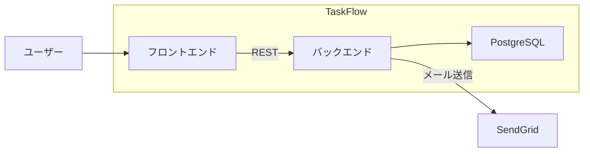

# アーキテクチャ図

TaskFlow のサブシステムと外部システムとの境界。

**ID**: ARCH-1

## システム全体図

<!-- map: {"title": "システム全体図"} -->

<!-- /map -->

<!-- table: {"kind": "data", "collapse": {"open": false}, "columns": {"ID": {"hidden": true}}} -->
| 表示 | ID | 要素の種類 |
| --- | --- | --- |
| ユーザー | U | actor |
| フロントエンド | FE | system |
| バックエンド | BE | system |
| PostgreSQL | DB | store |
| SendGrid | MAIL | external |
<!-- /table -->

<!-- table: {"kind": "data", "collapse": {"open": false}} -->
| ラベル | 元 | 先 |
| --- | --- | --- |
|  | U | FE |
| REST | FE | BE |
|  | BE | DB |
| メール送信 | BE | MAIL |
<!-- /table -->

## リポジトリ構成

**方式**: モノレポ

<!-- table: {"kind": "data"} -->
| リポジトリ |
| --- |
| owner/taskflow |
<!-- /table -->

## サブシステム一覧

<!-- table: {"kind": "data"} -->
| サブシステム | scope | 役割 | 言語・ランタイム |
| --- | --- | --- | --- |
| フロントエンド | frontend | 画面の描画とユーザー操作の受付 | TypeScript 5 / Node.js 22 |
| バックエンド | backend | 業務ロジックと永続化 | Python 3.12 |
<!-- /table -->

## 外部システム連携

<!-- table: {"kind": "data"} -->
| 外部システム | 用途 | 方向 | 技術 | 詳細 | 対応する非機能要件のテスト | 料金・副作用 |
| --- | --- | --- | --- | --- | --- | --- |
| SendGrid | メール送信 | 送信のみ | HTTPS | API-1# | tests/external/test_sendgrid.py | 副作用: 実メールを送信する |
| 認証基盤（銘柄未定） | ユーザー認証 | 双方向 |  |  |  |  |
<!-- /table -->
