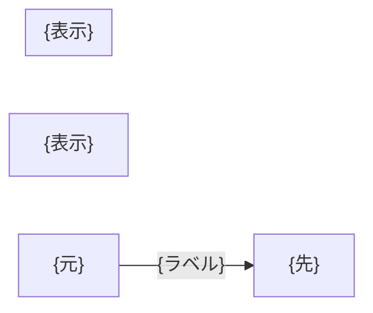

# {タイトル}

{冒頭リード}

**ID**: {ID}

**公開範囲**: public / internal

**タグ**

<!-- table: {"kind": "data"} -->
| タグの名前 | 主題 |
| --- | --- |
| {タグの名前} | true / false |
<!-- /table -->

**別名**

- {別名}

## システム全体図

<!-- map: {"title": "システム全体図"} -->

<!-- map-data: {"version": 1, "notes": {"n1": {"text": "{説明}"}, "n2->n3": {"text": "{詳細}"}}} -->

<!-- /map -->

<!-- table: {"kind": "data", "collapse": {"open": false}, "columns": {"ID": {"hidden": true}}} -->
| 表示 | ID | 要素の種類 | 説明 |
| --- | --- | --- | --- |
| {表示} | {ID} | actor / process / store / system / external / start / question / action / result | {説明} |
<!-- /table -->

<!-- table: {"kind": "data", "collapse": {"open": false}} -->
| ラベル | 元 | 先 | 線 | 詳細 |
| --- | --- | --- | --- | --- |
| {ラベル} | {元} | {先} | flow / read / write / reply / loop | {詳細} |
<!-- /table -->

<!-- table: {"kind": "data", "collapse": {"open": false}} -->
| ノード | リンク先 |
| --- | --- |
| {ノード} | {リンク先} |
<!-- /table -->

## リポジトリ構成

**方式**: モノレポ / ポリレポ

<!-- table: {"kind": "data"} -->
| リポジトリ | サブシステム |
| --- | --- |
| {リポジトリ} | {サブシステム} |
<!-- /table -->

**補足**: {補足}

## サブシステム一覧

<!-- table: {"kind": "data"} -->
| サブシステム | scope | 役割 | 言語・ランタイム | どこで動くか | 関連 | 検討事項 | 理由 | 状態 | 公開 |
| --- | --- | --- | --- | --- | --- | --- | --- | --- | --- |
| {サブシステム} | {scope} | {役割} | {言語・ランタイム} | {どこで動くか} | to: {相手の ID}、item: {項目のパス}、type: requires / references / replaces / part_of / change_together、when: {いつ参照するか}、paths: ['{対象のパス}'] | {検討事項} | {理由} | planned / implemented / deprecated / removed | user / developer |
<!-- /table -->

## 外部システム連携

<!-- table: {"kind": "data"} -->
| 外部システム | 用途 | 方向 | 技術 | 詳細 | 対応する非機能要件のテスト | 料金・副作用 | 関連 | 検討事項 | 理由 | 状態 | 公開 |
| --- | --- | --- | --- | --- | --- | --- | --- | --- | --- | --- | --- |
| {外部システム} | {用途} | 送信のみ / 受信のみ / 双方向 | {技術} | {詳細} | {対応する非機能要件のテスト} | {料金・副作用} | to: {相手の ID}、item: {項目のパス}、type: requires / references / replaces / part_of / change_together、when: {いつ参照するか}、paths: ['{対象のパス}'] | {検討事項} | {理由} | planned / implemented / deprecated / removed | user / developer |
<!-- /table -->

## 品質目標

{品質目標}

## 制約

{制約}

## 横断の方針

{横断の方針}

**関連**

<!-- table: {"kind": "data"} -->
| 相手の ID | 項目のパス | 関係の種類 | いつ参照するか | 対象のパス |
| --- | --- | --- | --- | --- |
| {相手の ID} | {項目のパス} | requires / references / replaces / part_of / change_together | {いつ参照するか} | {対象のパス} |
<!-- /table -->

**検討事項**

- {検討事項}
