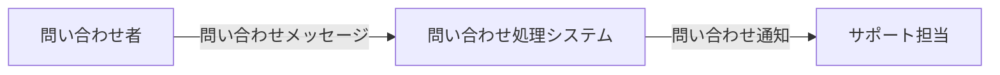
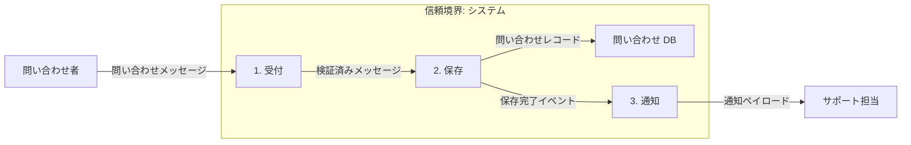

# 問い合わせメッセージ

`問い合わせメッセージ` がシステムを流れる過程。

<!-- table: {"kind": "plain"} -->
| 項目 | 値 |
| --- | --- |
| ID | DF-1 |
| 発生源 | 問い合わせ者 |
| 出口 | 問い合わせ DB とサポート担当 |
<!-- /table -->

## Level 0

<!-- map: {"title": "図"} -->

<!-- /map -->

<!-- table: {"kind": "data", "collapse": {"open": false}, "columns": {"ID": {"hidden": true}}} -->
| 表示 | ID | 要素の種類 |
| --- | --- | --- |
| 問い合わせ者 | USER | actor |
| 問い合わせ処理システム | S | process |
| サポート担当 | SUP | actor |
<!-- /table -->

<!-- table: {"kind": "data", "collapse": {"open": false}} -->
| ラベル | 元 | 先 |
| --- | --- | --- |
| 問い合わせメッセージ | USER | S |
| 問い合わせ通知 | S | SUP |
<!-- /table -->

## Level 1

<!-- map: {"title": "図"} -->

<!-- /map -->

<!-- table: {"kind": "data", "collapse": {"open": false}, "columns": {"ID": {"hidden": true}}} -->
| 表示 | ID | 要素の種類 |
| --- | --- | --- |
| 問い合わせ者 | USER | actor |
| 1. 受付 | P1 | process |
| 2. 保存 | P2 | process |
| 問い合わせ DB | DB | store |
| 3. 通知 | P3 | process |
| サポート担当 | SUP | actor |
<!-- /table -->

<!-- table: {"kind": "data", "collapse": {"open": false}} -->
| ラベル | 元 | 先 |
| --- | --- | --- |
| 問い合わせメッセージ | USER | P1 |
| 検証済みメッセージ | P1 | P2 |
| 問い合わせレコード | P2 | DB |
| 保存完了イベント | P2 | P3 |
| 通知ペイロード | P3 | SUP |
<!-- /table -->

## データ辞書

<!-- table: {"kind": "data"} -->
| データフロー名 | 発生元 | 到達先 | 構造 | 信頼境界を越える | 機密の区分 | 脅威 |
| --- | --- | --- | --- | --- | --- | --- |
| 問い合わせメッセージ | 問い合わせ者 | 1. 受付 | {name, email, subject, body} | ✓ | 個人情報 | 改ざん・情報漏えい |
| 問い合わせレコード | 2. 保存 | 問い合わせ DB | {id, name, email, subject, body, received_at} |  |  |  |
<!-- /table -->
