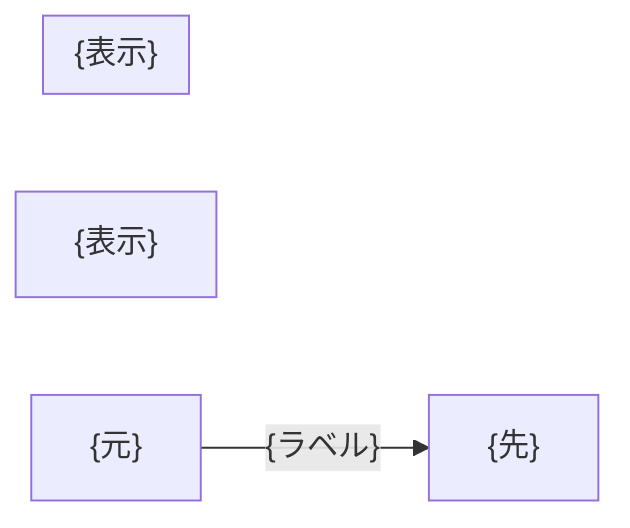

# {タイトル}

{冒頭リード}

**ID**: {ID}

**公開範囲**: public / internal

**タグ**

<!-- table: {"kind": "data"} -->
| タグの名前 | 主題 |
| --- | --- |
| {タグの名前} | true / false |
<!-- /table -->

**別名**

- {別名}

**発生源**: {発生源}

**出口**: {出口}

## {レベル}

**説明**: {説明}

<!-- map: {"title": "図"} -->

<!-- map-data: {"version": 1, "notes": {"n1": {"text": "{説明}"}, "n2->n3": {"text": "{詳細}"}}} -->

<!-- /map -->

<!-- table: {"kind": "data", "collapse": {"open": false}, "columns": {"ID": {"hidden": true}}} -->
| 表示 | ID | 要素の種類 | 説明 |
| --- | --- | --- | --- |
| {表示} | {ID} | actor / process / store / system / external / start / question / action / result | {説明} |
<!-- /table -->

<!-- table: {"kind": "data", "collapse": {"open": false}} -->
| ラベル | 元 | 先 | 線 | 詳細 |
| --- | --- | --- | --- | --- |
| {ラベル} | {元} | {先} | flow / read / write / reply / loop | {詳細} |
<!-- /table -->

<!-- table: {"kind": "data", "collapse": {"open": false}} -->
| ノード | リンク先 |
| --- | --- |
| {ノード} | {リンク先} |
<!-- /table -->

## データ辞書

<!-- table: {"kind": "data", "columns": {"補足": {"width": {"mode": "nowrap"}}}} -->
| データフロー名 | 発生元 | 到達先 | 構造 | 信頼境界を越える | 機密の区分 | 脅威 | 頻度と量 | 補足 |
| --- | --- | --- | --- | --- | --- | --- | --- | --- |
| {データフロー名} | {発生元} | {到達先} | {構造} | true / false | 個人情報 / 機密 | なりすまし / 改ざん / 否認 / 情報漏えい / サービス拒否 / 権限昇格 | {頻度と量} | {補足} |
<!-- /table -->

**関連**

<!-- table: {"kind": "data"} -->
| 相手の ID | 項目のパス | 関係の種類 | いつ参照するか | 対象のパス |
| --- | --- | --- | --- | --- |
| {相手の ID} | {項目のパス} | requires / references / replaces / part_of / change_together | {いつ参照するか} | {対象のパス} |
<!-- /table -->

**検討事項**

- {検討事項}
