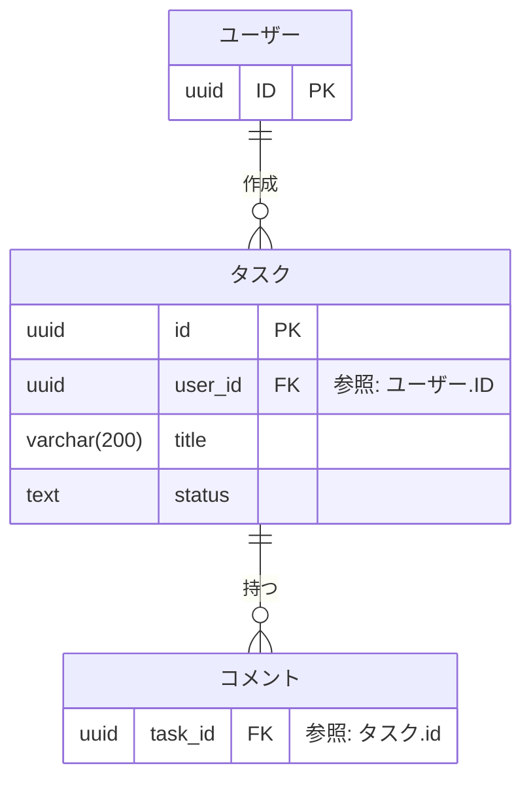

# タスク

`タスク` ドメインに属するデータストア構造。

**ID**: ER-1

## ER 図

<!-- map: {"title": "ER 図"} -->

<!-- map-data: {"version": 1, "notes": {"タスク.id": {"text": "ID"}, "タスク.user_id": {"text": "ユーザー ID"}, "タスク.title": {"text": "タイトル"}, "タスク.status": {"text": "ステータス"}}} -->

<!-- /map -->

<!-- table: {"kind": "data", "collapse": {"open": false}} -->
| 名前 | カラム |
| --- | --- |
| ユーザー | type: uuid、name: ID、key: PK |
| タスク |  |
| コメント | type: uuid、name: task_id、key: FK |
<!-- /table -->

<!-- table: {"kind": "data", "collapse": {"open": false}} -->
| ラベル | 元 | 先 | 元の列 | 先の列 | 元の多重度 | 先の多重度 |
| --- | --- | --- | --- | --- | --- | --- |
| 作成 | ユーザー | タスク | ID | user_id | 1 | 0..n |
| 持つ | タスク | コメント | id | task_id | 1 | 0..n |
<!-- /table -->

## テーブル

### tasks

<!-- table: {"kind": "plain"} -->
| 項目 | 値 |
| --- | --- |
| 論理名 | タスク |
| 保存するデータ | DATA-1# |
| データストア | PostgreSQL |
| 概要 | ユーザーが管理するタスク |
| 主キー | id |
| レコード規模 | ～500 万 |
| 削除の方針 | `status='archived'` で論理削除し、90 日後に物理削除する |
<!-- /table -->

#### カラム

<!-- table: {"kind": "data", "columns": {"説明": {"width": {"mode": "nowrap"}}}} -->
| 物理名 | 論理名 | 保存するキー | 型 | NOT NULL | 主キー | 外部キー | 検査制約 | 既定 | 自動で入る値 | 説明 | 例 | 値の選択肢 |
| --- | --- | --- | --- | --- | --- | --- | --- | --- | --- | --- | --- | --- |
| id | ID |  | uuid | ✓ | ✓ |  |  | gen_random_uuid() | 採番 | 主キー | 018f8a... |  |
| user_id | ユーザー ID |  | uuid | ✓ |  | ユーザー/ユーザー.ID |  |  |  | 所有ユーザー |  |  |
| title | タイトル | DATA-1#fields[title] | varchar(200) | ✓ |  |  | 1〜200 文字 |  |  | タスクのタイトル | 週次レポート作成 |  |
| status | ステータス |  | text | ✓ |  |  |  | 'open' |  | タスクの状態 |  | 'open' = 未着手 / 'done' = 完了 / 'archived' = 論理削除 |
<!-- /table -->

#### インデックス

<!-- table: {"kind": "data", "columns": {"補足": {"width": {"mode": "nowrap"}}}} -->
| 名前 | カラム | 種別 | 条件 | 補足 |
| --- | --- | --- | --- | --- |
| tasks_user_id_ix | user_id | BTREE | status <> 'archived' | ユーザー別の一覧用 |
<!-- /table -->

### comments

<!-- table: {"kind": "plain"} -->
| 項目 | 値 |
| --- | --- |
| 論理名 | コメント |
| 保存するデータ | DATA-1#fields[comments[]] |
| データストア | PostgreSQL |
| 概要 | タスクへのコメント |
| 主キー | id |
| レコード規模 | ～1000 万 |
| 同じトランザクションのテーブル | tasks |
<!-- /table -->

#### カラム

<!-- table: {"kind": "data", "columns": {"説明": {"width": {"mode": "nowrap"}}}} -->
| 物理名 | 論理名 | 型 | NOT NULL | 主キー | 外部キー | 自動で入る値 | 説明 |
| --- | --- | --- | --- | --- | --- | --- | --- |
| id | ID | uuid | ✓ | ✓ |  | 採番 | 主キー |
| task_id | タスク ID | uuid | ✓ |  | [タスク.ID](#tasks) |  | コメント先のタスク |
| body | 本文 | text | ✓ |  |  |  | コメントの本文 |
<!-- /table -->
