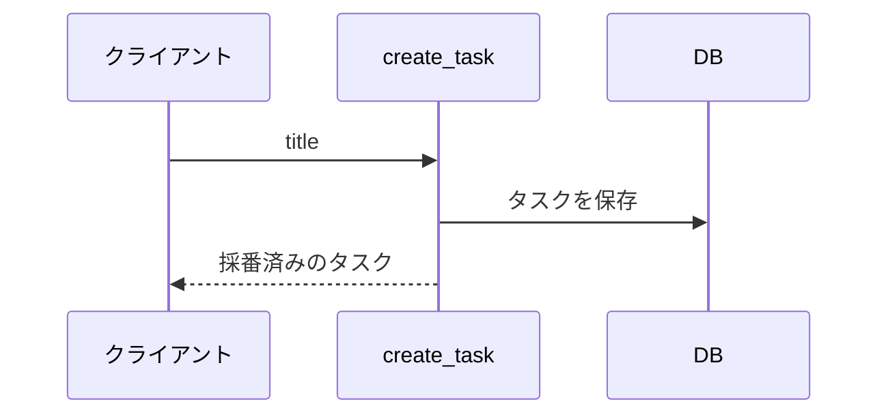

# タスク作成

タイトルとサブタスクを受け取ってタスクを永続化し、採番済みのタスクを返却する。

**ID**: IF-1

<!-- table: {"kind": "plain"} -->
| 項目 | 値 |
| --- | --- |
| 種類 | operation |
| 値 | `create_task`（サービス層の公開関数） |
<!-- /table -->

<!-- table: {"kind": "plain", "collapse": {"open": false}} -->
| 対応テストファイル |
| --- |
| `tests/integration/task/test_create_task.py` |
<!-- /table -->

- src/task/service/create_task.py

## リクエスト

<!-- table: {"kind": "data", "columns": {"説明": {"width": {"mode": "nowrap"}}}} -->
| パラメータ | 型 | 必須 | 配置場所 | 説明 | 制限 |
| --- | --- | --- | --- | --- | --- |
| title | str | ✓ | argument | タスク名 | 100 文字以内 |
<!-- /table -->

## 例外

<!-- table: {"kind": "data"} -->
| 例外 | 発生条件 |
| --- | --- |
| なし（正常終了） | 作成成功 |
| ValidationError | タイトルが 100 文字を超える |
<!-- /table -->

## 制約

<!-- table: {"kind": "data"} -->
| 項目 | 制約 |
| --- | --- |
| タイムアウト | 制限なし |
<!-- /table -->

## フロー

### 正常系

**概要**: タスクを作成する

#### セットアップ

<!-- table: {"kind": "data", "columns": {"説明": {"width": {"mode": "nowrap"}}}} -->
| セットアップ | 説明 |
| --- | --- |
| Mock | DB を stub に差し替え |
<!-- /table -->

#### フロー

<!-- map -->

<!-- map: {"title": "フロー"} -->

<!-- /map -->

<!-- /map -->

#### 期待値

- 採番済みのタスクが返る
- DB にタスクが 1 件ある

**テスト**: test_normal
