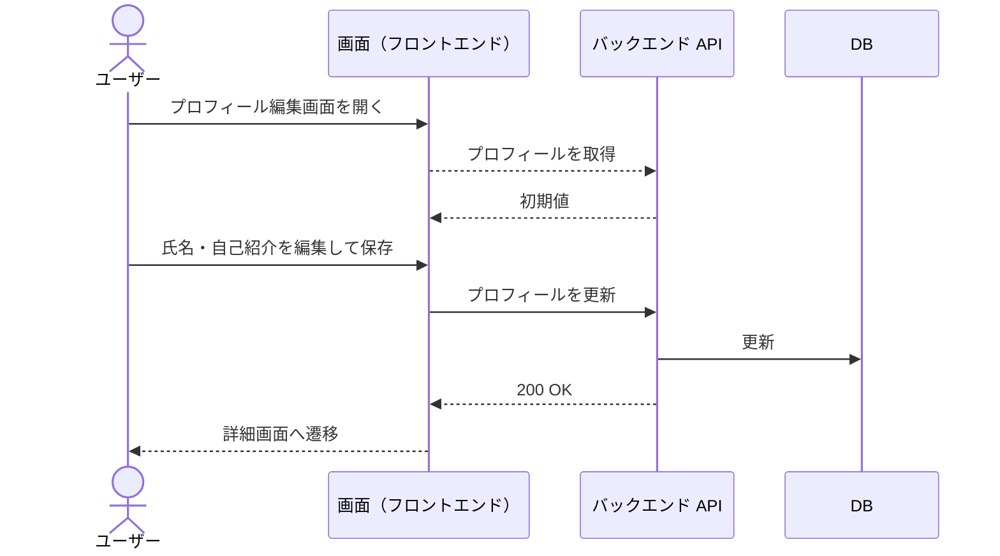
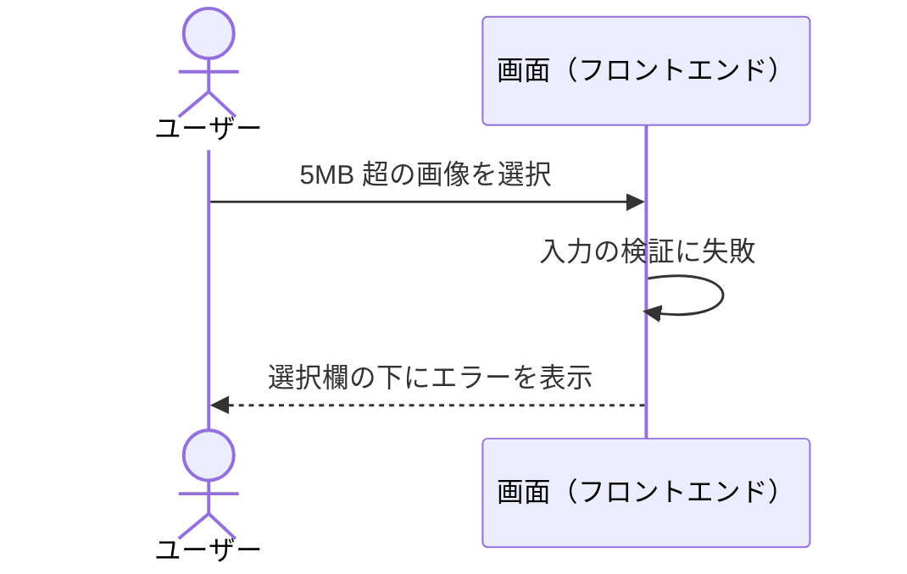

# プロフィール編集

ログイン中のユーザーが自身のプロフィール（氏名・自己紹介・アバター画像）を編集する単一ユースケース。

**ID**: SC-1

<!-- table: {"kind": "plain", "collapse": {"open": false}} -->
| 対応テストファイル |
| --- |
| `tests/e2e/単一ユースケース/test_profile_edit.py` |
<!-- /table -->

**主アクター**: ログイン中のユーザー

**きっかけ**: プロフィール編集画面を開く

- ユーザーがログインしている

## シナリオ

### 正常シナリオ

#### セットアップ

<!-- table: {"kind": "data", "columns": {"説明": {"width": {"mode": "nowrap"}}, "補足": {"width": {"mode": "nowrap"}}}} -->
| セットアップ | 説明 | 補足 |
| --- | --- | --- |
| Mock | なし（実環境で実行） |  |
| createUser | ログイン中のユーザー A |  |
| createProfile | ユーザー A に紐づくプロフィール | `visible: true` |
<!-- /table -->

#### フロー

<!-- map -->

<!-- map: {"title": "フロー"} -->

<!-- /map -->

<!-- /map -->

#### 期待値

- プロフィール表示画面に編集後の氏名・自己紹介が表示されている
- DB の該当プロフィールが編集後の値になっている

**テスト**: test_normal

### 異常シナリオ（5MB 超の画像アップロード）

#### セットアップ

<!-- table: {"kind": "data", "columns": {"説明": {"width": {"mode": "nowrap"}}}} -->
| セットアップ | 説明 |
| --- | --- |
| Mock | なし（実環境で実行） |
| createUser | ログイン中のユーザー A |
<!-- /table -->

#### フロー

<!-- map -->

<!-- map: {"title": "フロー"} -->

<!-- /map -->

<!-- /map -->

#### 期待値

- エラーが表示され、画像が選ばれていない

**テスト**: test_error_when_image_too_large
