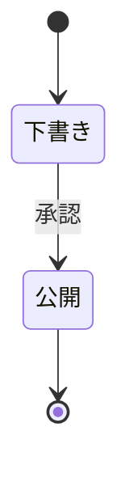

# 記事

`記事` が取りうる状態と許可された遷移の一覧。

**ID**: ST-1

## 状態遷移図

<!-- map: {"title": "状態遷移"} -->

<!-- /map -->

<!-- table: {"kind": "data", "collapse": {"open": false}} -->
| 状態名 | 識別子 |
| --- | --- |
| 下書き | status = draft |
| 公開 | status = published |
<!-- /table -->

<!-- table: {"kind": "data", "collapse": {"open": false}} -->
| 元 | 先 | きっかけ |
| --- | --- | --- |
| 下書き | 公開 | 承認 |
<!-- /table -->
