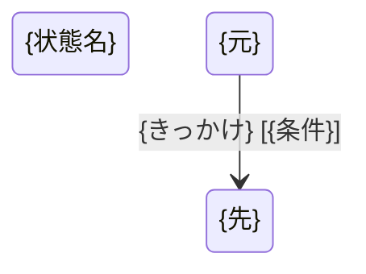

# {タイトル}

{冒頭リード}

**ID**: {ID}

**公開範囲**: public / internal

**タグ**

<!-- table: {"kind": "data"} -->
| タグの名前 | 主題 |
| --- | --- |
| {タグの名前} | true / false |
<!-- /table -->

**別名**

- {別名}

## 状態遷移図

<!-- map: {"title": "状態遷移"} -->

<!-- /map -->

<!-- table: {"kind": "data", "collapse": {"open": false}, "columns": {"補足": {"width": {"mode": "nowrap"}}}} -->
| 状態名 | 識別子 | 備考識別子 | 入る条件 | 入る値 | 入る時の処理 | 出る時の処理 | 補足 |
| --- | --- | --- | --- | --- | --- | --- | --- |
| {状態名} | {識別子} | {備考識別子} | {入る条件} | {入る値} | {入る時の処理} | {出る時の処理} | {補足} |
<!-- /table -->

<!-- table: {"kind": "data", "collapse": {"open": false}} -->
| 元 | 先 | きっかけ | 条件 | そのときの処理 | 状態を出ない | 代表 | 注記 |
| --- | --- | --- | --- | --- | --- | --- | --- |
| {元} | {先} | {きっかけ} | {条件} | {そのときの処理} | true / false | {代表} | {注記} |
<!-- /table -->

**関連**

<!-- table: {"kind": "data"} -->
| 相手の ID | 項目のパス | 関係の種類 | いつ参照するか | 対象のパス |
| --- | --- | --- | --- | --- |
| {相手の ID} | {項目のパス} | requires / references / replaces / part_of / change_together | {いつ参照するか} | {対象のパス} |
<!-- /table -->

**検討事項**

- {検討事項}
